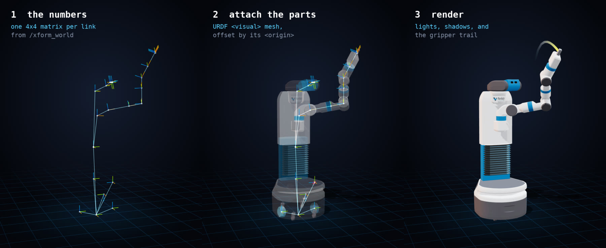
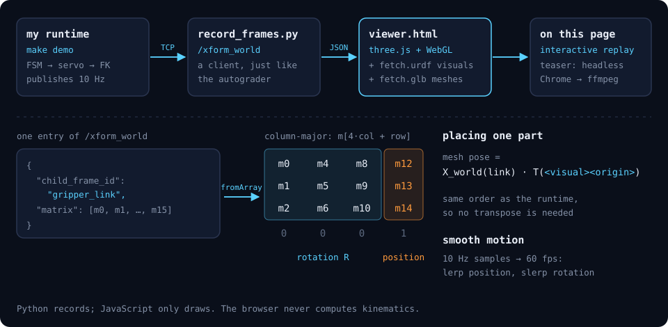

# Project 3: Forward Kinematics

<video autoplay loop muted playsinline controls width="100%" poster="poster.jpg">
  <source src="teaser.mp4" type="video/mp4">
  Your browser cannot play this video. <a href="teaser.mp4">Download it (MP4)</a>.
</video>

A Fetch robot says hello. Every pose in this video comes from my own forward-kinematics runtime:
no kinematics or transform libraries, just quaternions and a walk down the URDF tree.

## Try it yourself

Drag to orbit and scroll to zoom. **frames** shows each link's coordinate frame and the `/tf`
tree that connects them. **trail** traces the gripper's path.

<iframe src="viewer.html" title="Interactive 3D replay of the Fetch choreography"
        style="width: 100%; aspect-ratio: 16 / 9; min-height: 420px; border: 0; border-radius: 8px;"
        loading="lazy" allowfullscreen></iframe>

## The robot

The Fetch mobile manipulator, loaded from its real, unmodified URDF: 26 links and 25 joints, 15
of which can move. A client sends the URDF to my parameter server.

- `robot_state_publisher` turns joint positions into one transform per joint on `/tf`.
- `robot_world_state_publisher` composes those transforms into every link's pose in the world on
  `/xform_world`.

All the nodes talk through a rosbridge-style TCP/JSON gateway.

## The choreography

`fetch_wave` is a finite state machine with seven states:

**home → hello → wave_out → wave_in → wave_out_again → wave_in_again → sweep → home**

- **hello** raises the torso and lifts the arm out to the left, with the forearm up and the head
  turned toward the hand.
- The four **wave** states swing the forearm by rolling the upper arm ±0.7 rad and flexing the
  wrist.
- **sweep** unfolds the arm into one long arc to the right.

Each state moves on when every joint it targets is within 0.04 rad (or m) of its goal. A joint
servo closes 20% of the remaining gap 10 times a second.

## How I drew it

The viewer never computes kinematics. Every pose it shows comes from my runtime's
`/xform_world` topic, which holds one 4×4 world matrix for each link. Drawing the robot means
attaching each part to its matrix, as the three panels show:

1. **The numbers.** Each link's matrix is drawn as a small RGB axis triad (x, y, z). The `/tf`
   tree connects the triads with lines. This skeleton is exactly what the runtime computed.
2. **Attach the parts.** The URDF gives every link a `<visual>`: a mesh file and an `<origin>`
   offset inside the link's frame. Each mesh goes in a three.js group whose matrix is that link's
   world matrix.
3. **Render.** Lights, soft shadows and a fading trail behind the gripper are added for looks.
   None of them change any pose.

**Getting the data out.** `record_frames.py` is an ordinary client of my runtime, just like the
autograder. It opens a TCP connection to the rosbridge-style gateway and subscribes to
`/xform_world`, `/tf` and `/fsm/status`. It then saves every message, ten per second, to
`frames.json`. A browser can't open a raw TCP socket, so the viewer replays this file instead
of connecting live.

**Placing a part.** `/xform_world` stores each matrix in column-major order: entry `m[4·col + row]`,
with the position in `m[12..14]`. three.js's `Matrix4.fromArray` reads that same order, so the
numbers go straight in with no transpose. A mesh's world pose is the link's world matrix times its
visual origin. The origin's `rpy` becomes a three.js Euler angle in `'ZYX'` order, which matches
URDF's R = Rz·Ry·Rx. ROS uses z as up, while three.js assumes y, so I set the camera's up vector
to z. I also undo the automatic y-up rotation that three.js applies when it loads Fetch's
COLLADA meshes.

**Smooth motion.** The runtime publishes ten times a second, but the screen redraws about sixty
times a second. Between two samples I split each matrix into a position and a quaternion. I
interpolate the position in a straight line and the rotation with slerp (spherical
interpolation). Interpolating the matrix entries directly would warp the parts in between
samples.

**The teaser.** The video at the top is the same page in a scripted mode. A headless Chrome
renders it one frame at a time, 30 frames for each second of the recording, with a moving
camera. ffmpeg then joins the frames into the MP4.

---

Fetch robot description © Fetch Robotics, Inc., [CC BY-NC-SA 4.0](https://creativecommons.org/licenses/by-nc-sa/4.0/)
(from [fetch_ros](https://github.com/fetchrobotics/fetch_ros)). The meshes were converted to a
compressed glTF file (`fetch.glb`) for the web; that adaptation is shared under the same license.
